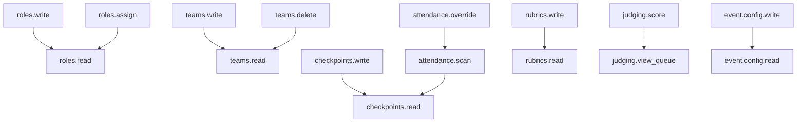

# Role-Based Access Control (RBAC) & Permissions Usage Guide

> **Version**: 10.4.0  
> **Target Audience**: Administrators, Event Organizers, Operations Staff, and Platform Engineers.

---

## 1. Overview & Architecture

The Event Management Platform features a **fine-grained Role-Based Access Control (RBAC)** engine that replaces traditional static role flags with granular capability checks. Every sensitive operation—whether reading teams, judging submissions, scanning attendance, or toggling event features—is guarded by an explicit permission key.

### Key Tenets
1. **Zero Hardcoded Roles**: New route handlers do not check `user.role == 'ADMIN'`. Instead, they check `require_permission(Permission.TEAMS_WRITE)`.
2. **Backward Compatibility**: System Administrators automatically hold all 46 permissions (`*`). Existing Volunteer and Judge accounts are automatically mapped to seeded roles.
3. **Dynamic Frontend Adaptation**: Navigation menus, action buttons, and volunteer dashboards adapt dynamically based on the authenticated user's permission set returned by `/api/auth/me`.
4. **Member Scoping**: Permissions can be scoped to specific **POD groups** or **Team IDs**, allowing granular delegation (e.g., a volunteer can only scan attendance for POD A).
5. **Fast Decisioning Cache**: Access decisions are cached in-memory with a 15-second TTL and immediate eviction when roles or assignments change.

---

## 2. Navigating the Roles & Access Interface

Administrators can manage the entire access control system from **Admin Dashboard &rarr; Roles & Access**.

The interface is structured into four main workflows:
1. **Role Catalog & Custom Role Editor**: Create, view, and modify custom roles.
2. **Granular Permissions Matrix**: Toggle individual permissions across 7 functional categories with instant visual feedback on dependencies and implication chains.
3. **Role Templates (Quick Setup)**: 1-click bootstrap predefined roles for standard event duties (e.g., Registration Desk, Lead Judge, Mentor).
4. **Member Assignments & Scoping**: Assign users to roles and bind them to specific PODs or teams.

---

## 3. The 46 Permissions Catalog

Permissions are organized into 7 logical tiers. Below is the exhaustive reference of all catalog keys:

### 3.1 System & Core Configuration
| Permission Key | Description | Scopable? | Implications / Notes |
|---|---|---|---|
| `system.info.read` | View backend and environment system status | No | Granted to Admins. |
| `system.logs.read` | View and export administrative audit logs | No | Requires elevated tier. |
| `event.config.read` | View global event configurations | No | Reading event details. |
| `event.config.write` | Modify event dates, configurations, and metadata | No | Implies `event.config.read`. |
| `event.features.manage` | Toggle event feature flags (e.g., PODs, Public PS) | No | Modifies module visibility platform-wide. |

### 3.2 Roles & Access Control
| Permission Key | Description | Scopable? | Implications / Notes |
|---|---|---|---|
| `roles.read` | View role definitions, templates, and assignments | No | Grants access to Roles & Access tab. |
| `roles.write` | Create and modify role definitions and permissions | No | Implies `roles.read`. |
| `roles.assign` | Assign roles to organizers, judges, and volunteers | No | Implies `roles.read`. |

### 3.3 Teams & Participants
| Permission Key | Description | Scopable? | Implications / Notes |
|---|---|---|---|
| `teams.read` | View registered teams, members, and details | Yes | Supports filtering by assigned POD. |
| `teams.write` | Edit team details, track assignments, and notes | Yes | Implies `teams.read`. |
| `teams.delete` | Delete or disqualify teams | No | High-risk administrative operation. |
| `teams.export` | Export teams and participant rosters to CSV/Excel | No | Data export permission. |
| `teams.credentials.reset` | Reset passwords and generate one-time credentials | Yes | Allows desk organizers to assist teams. |

### 3.4 Attendance & Checkpoints
| Permission Key | Description | Scopable? | Implications / Notes |
|---|---|---|---|
| `checkpoints.read` | View attendance checkpoints and history | Yes | Can be scoped to specific checkpoint slots. |
| `checkpoints.write` | Create or update attendance checkpoints | No | Implies `checkpoints.read`. |
| `attendance.scan` | Scan QR codes and log attendance for teams | Yes | Typical volunteer/desk duty. |
| `attendance.override` | Manually mark attendance without scanning QR | Yes | Implies `attendance.scan`. |
| `attendance.export` | Export attendance tracking logs | No | Attendance reporting. |

### 3.5 Problem Statements (PS)
| Permission Key | Description | Scopable? | Implications / Notes |
|---|---|---|---|
| `ps.read` | View problem statements and submission tracks | No | Base reading capability. |
| `ps.write` | Create, update, or archive problem statements | No | Implies `ps.read`. |
| `ps.allocate` | Run automated or manual team-to-PS allocation | No | Administrative track allocation. |
| `ps.export` | Export problem statement preferences and allocations | No | PS reporting. |

### 3.6 Evaluation, Rounds & Rubrics
| Permission Key | Description | Scopable? | Implications / Notes |
|---|---|---|---|
| `rounds.read` | View evaluation rounds, schedules, and criteria | No | View round timelines and rules. |
| `rounds.write` | Create, edit, or delete evaluation rounds | No | Implies `rounds.read`. |
| `rounds.toggle_judging`| Enable or disable active judging for a round | No | Round lifecycle management. |
| `rubrics.read` | View scoring rubrics, criteria, and scale | No | Rubric inspection. |
| `rubrics.write` | Draft, modify, and publish rubric versions | No | Implies `rubrics.read`. |
| `rubrics.lock` | Permanently lock a rubric after judging starts | No | Guarantees rubric immutability. |

### 3.7 Judging, Scoring & Results
| Permission Key | Description | Scopable? | Implications / Notes |
|---|---|---|---|
| `panels.read` | View judging panels and judge rosters | Yes | Panel viewing. |
| `panels.manage` | Create panels, assign judges, and bind PODs | No | Panel organization. |
| `judging.view_queue` | View the evaluation queue for assigned teams | Yes | Judge console capability. |
| `judging.score` | Submit and edit evaluation scores according to rubric | Yes | Implies `judging.view_queue`. |
| `judging.override` | Edit or normalize scores submitted by other judges | No | Chief Judge / Admin override. |
| `results.read` | View compiled scores, rankings, and leaderboard | No | Viewing results dashboard. |
| `results.release` | Publish round results or winners to participants | No | Public release capability. |

---

## 4. Permission Implications (Auto-Cascading)

The permission engine enforces **logical implication chains**. When you grant a higher-tier permission, dependent read permissions are automatically granted:



> [!TIP]
> In the UI, checking a parent permission (such as `teams.write`) automatically checks and greys out `teams.read`. Unchecking the child will automatically uncheck parent permissions that require it.

---

## 5. Built-in Roles & Role Templates

### 5.1 System Roles
1. **Administrator (`ADMIN`)**:
   - Master account with unrestricted access across all modules.
   - Automatically bypasses permission checks (`*`).
2. **Volunteer (`VOLUNTEER`)**:
   - Seeded operational role with default permissions: `teams.read`, `checkpoints.read`, `attendance.scan`.
3. **Judge (`JUDGE`)**:
   - Seeded evaluation role with default permissions: `rounds.read`, `rubrics.read`, `judging.view_queue`, `judging.score`.

### 5.2 Predefined Role Templates
When creating a custom role, use the **Template Selector** to populate standard permission sets in one click:

| Template Name | Recommended Duties | Included Permissions |
|---|---|---|
| **Registration Desk** | Check-in, badge printing, team credentials reset | `teams.read`, `teams.credentials.reset`, `checkpoints.read`, `attendance.scan`, `attendance.override` |
| **Attendance Marshal** | Floor check-ins, meal slot scans | `checkpoints.read`, `attendance.scan` |
| **Track Mentor** | Mentoring and viewing problem statements | `teams.read`, `ps.read` |
| **Evaluation Judge** | Scoring assigned teams in judging rounds | `rounds.read`, `rubrics.read`, `panels.read`, `judging.view_queue`, `judging.score` |
| **Chief Judge / Track Lead** | Managing panels, overriding scores, viewing results | Evaluation Judge permissions + `panels.manage`, `judging.override`, `results.read` |

---

## 6. Member Scoping (POD & Team Restrictions)

When assigning a role to a user, administrators can configure **Scope Restrictions**:

### Supported Scope Types:
1. **Global (`scopeType: 'global'`)**:
   - The user exercises their granted permissions across the entire event.
2. **POD Scoped (`scopeType: 'pod'`, `scopeValue: '<pod_id>'`)**:
   - The user can only view teams and scan attendance for teams allocated to that specific POD.
   - Ideal for large multi-hall hackathons where volunteers are stationed in distinct physical rooms.
3. **Team Scoped (`scopeType: 'team'`, `scopeValue: '<team_id>'`)**:
   - The user is bound strictly to a specific team (e.g., a dedicated team mentor).

### How Scoping is Enforced:
- **Backend API**: Whenever an endpoint calls `principal.filter_team_query(query)`, SQLAlchemy queries automatically append `WHERE team.podId = :scope_value` if the user has a POD-scoped assignment.
- **Frontend**: The staff/volunteer screen highlights the assigned scope label (e.g., `Scoped: Room 101 - Track A`) and hides teams outside the designated scope.

---

## 7. Event Feature Flags

Administrators can toggle system modules on or off per event under **Roles & Access &rarr; Event Features**:

| Feature Toggle | When Disabled (`false`) |
|---|---|
| `pods` | Hides the POD Groups navigation tab and disables POD clustering in team tables. |
| `checkpoints` | Hides attendance slots and QR scan operations. |
| `rubrics` | Uses simple total scoring instead of multi-criteria rubrics. |
| `leaderboards` | Disables live public ranking displays. |
| `public_ps` | Restricts problem statement visibility strictly to verified participants. |

---

## 8. Developer Quick Reference

### In Backend Routes (`FastAPI`):
```python
from fastapi import APIRouter, Depends
from app.services.rbac import require_permission, Principal
from app.constants.permissions import Permission

router = APIRouter()

# Guard an endpoint by permission:
@router.post("/teams/{team_id}/notes")
def add_team_note(
    team_id: str,
    principal: Principal = Depends(require_permission(Permission.TEAMS_WRITE))
):
    # Enforce scope if caller is scoped to a specific team or POD
    principal.assert_team_access(team_id)
    ...
```

### In Frontend Components (`React`):
```jsx
import { useAuth } from '../contexts/AuthContext';

function TeamActionMenu({ team }) {
  const { can, canAny, features } = useAuth();

  return (
    <div>
      {can('teams.write') && (
        <button onClick={handleEdit}>Edit Team</button>
      )}

      {can('teams.credentials.reset') && (
        <button onClick={handleResetPassword}>Reset Password</button>
      )}

      {features?.pods && (
        <span>Assigned POD: {team.podName}</span>
      )}
    </div>
  );
}
```

---

## 9. Security & Audit Trail

- **Immediate Invalidation**: Changing a role's permissions or revoking a member's assignment automatically evicts cached permissions across all worker processes.
- **Audit Logging**: Every role creation, permission modification, template application, and member assignment logs an entry in `audit_logs` with `eventId`, `userId`, action payload, and timestamp.
- **Account Disablement**: If a user's status is set to `disabled` in the database, all authentication and API calls are rejected immediately with `401 Unauthorized`.
